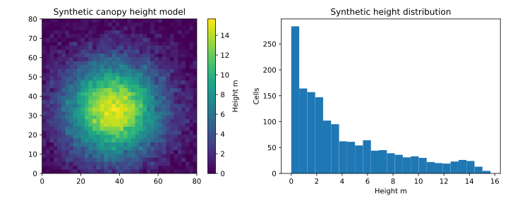

# LiDAR Canopy Structure and Terrain Analysis

Read classified LAS/LAZ point clouds, normalize heights against ground returns and summarize canopy structure. The public Python workflow includes a reproducible synthetic canopy example and reusable forestry metrics.

## Implemented workflows

| Component | Function |
|---|---|
| `real_laz_ingestion.py` | Read LAS/LAZ coordinates, class and return attributes |
| `ground_normalize` | Subtract median class-2 ground height within each grid cell |
| `lidar_metrics.py` | Canopy mean/p95/max height and cover summaries |
| `forest_inventory_extension.py` | CHM summaries, paired-height validation, change and an illustrative priority score |
| `scripts/run_demo.py` | Generate classified points, normalize heights, save surfaces and plot results |

## Quick start

```bash
python -m pip install -r requirements.txt
python scripts/run_demo.py
python -m pytest -q
```



The demo writes [metrics](results/canopy_metrics.json), normalized point records and `results/synthetic_surfaces.npz` containing DTM, DSM and CHM arrays. These values are generated and are not a field inventory or a completed NAIP classification.

## Use public LAS/LAZ data

```bash
python -m src.real_laz_ingestion /path/to/classified_points.laz
```

Use [the public-data guide](docs/usgs_3dep_real_data.md) to obtain authorized classified point clouds. Coordinates and heights must be in appropriate metre units before using the defaults. Cells without class-2 ground points retain missing normalized heights. The baseline does not interpolate terrain across missing-ground cells.

## Canopy cover and interpretation

Gridded CHM cover is the fraction of valid cells above the height threshold. A point-table fraction measures sampled returns and is not automatically an area-based canopy cover estimate. Review point density, ground classification, vertical datum, missing cells and co-registration before comparing dates.

LiDAR + NAIP fusion, urban-canopy classification and planting-opportunity mapping are applications of these methods, not fully reproduced outputs of the current Python demo. Independent field heights are required for validation claims.

[Forestry methods and extensions](docs/FORESTRY_LIDAR_UAV_EXTENSION.md) · [Verification notes](docs/verification.md)
